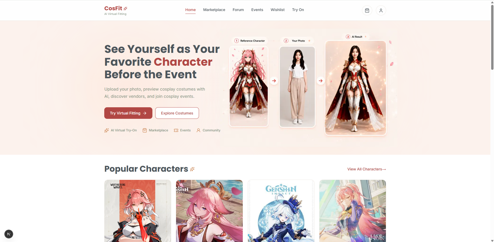
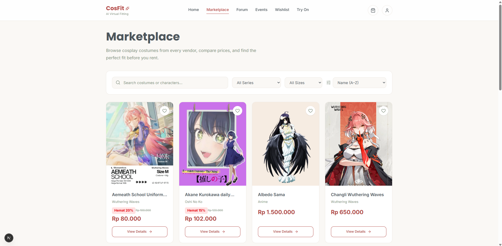
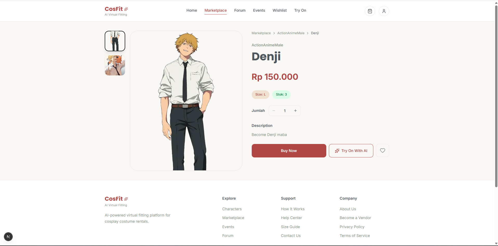
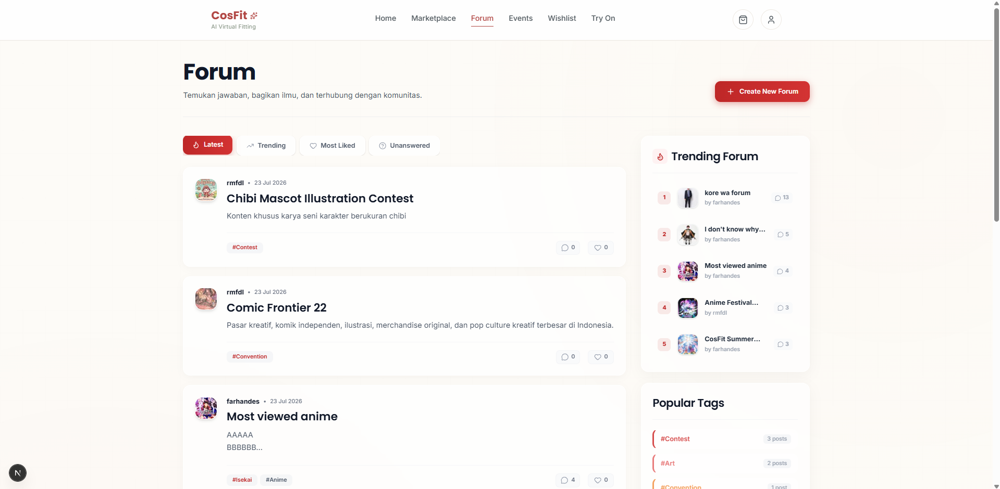
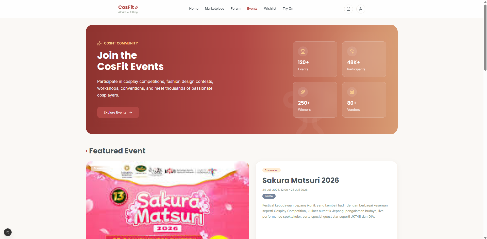
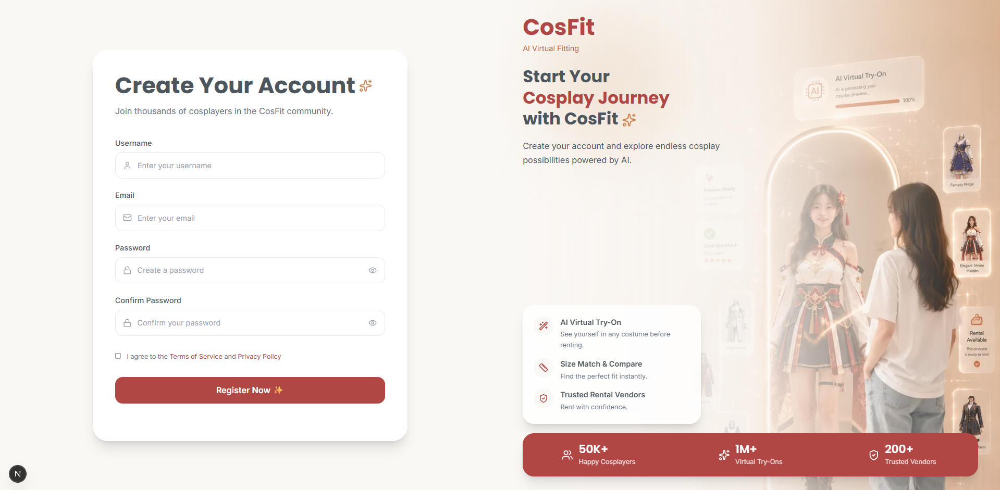

# CosFit — AI Virtual Fitting for Cosplay

CosFit is a full-stack cosplay platform built as a Hacktiv8 final project. Users can rent costumes from vendors, try costumes on virtually with AI before they buy, join cosplay events and design contests, and talk with the community in a real-time forum.



---

## Features

| Area                  | What it does                                                                                                                                 |
| --------------------- | -------------------------------------------------------------------------------------------------------------------------------------------- |
| **Marketplace**       | Browse and search costumes by character or theme, see popular and featured items, add to wishlist and cart                                   |
| **AI Virtual Try-On** | Upload a full-body photo and see yourself wearing the costume (Fashn.ai). An AI validator checks the photo first. Uses a token/credit system |
| **Checkout & Top Up** | Pay with Midtrans Snap (sandbox). Payment status is verified server-side before stock or credits change                                      |
| **Forum**             | Create discussions with images, like posts, comment in real time (Socket.IO), filter by trending, most liked or unanswered                   |
| **Events**            | External conventions and internal design contests with entry submission, voting (one vote per user) and a hall of fame                       |
| **Vendor Dashboard**  | Vendors register a shop, manage products and image galleries, and track stock and wishlists                                                  |
| **Admin Dashboard**   | Create, edit and delete events. Each new event gets its own forum automatically                                                              |

---

## Screenshots

### Marketplace



### Product Detail



### Forum



### Events



### Register



---

## Tech Stack

| Layer        | Technology                                                                                      |
| ------------ | ----------------------------------------------------------------------------------------------- |
| Framework    | [Next.js 16](https://nextjs.org/docs) (App Router, Route Handlers, `proxy.ts`) + React 19       |
| Language     | TypeScript                                                                                      |
| Styling      | Tailwind CSS v4, Lucide icons                                                                   |
| Database     | MongoDB (official [Node.js driver](https://www.mongodb.com/docs/drivers/node/current/), no ORM) |
| Auth         | JWT in an `httpOnly` cookie, bcrypt password hashing, role-based access (User / Vendor / Admin) |
| Validation   | Zod                                                                                             |
| Real-time    | Socket.IO on a custom Node HTTP server (`server.ts`)                                            |
| Payments     | [Midtrans Snap](https://docs.midtrans.com/docs/snap-snap-integration-guide)                     |
| File storage | [Vercel Blob](https://vercel.com/docs/vercel-blob)                                              |
| AI           | [Fashn.ai](https://fashn.ai) (try-on), [OpenRouter](https://openrouter.ai) (photo validation)   |
| Rich text    | Tiptap editor, `sanitize-html` on the server                                                    |

---

## Project Structure

```
final-project/
├── app/
│   ├── api/              # REST API (Next.js Route Handlers)
│   │   ├── user/         # register, login, profile, product, wishlist, checkout, try-on, token
│   │   ├── vendor/       # register, login, profile, product, gallery
│   │   ├── admin/events/ # admin event CRUD + upload
│   │   ├── forum/        # forum list, create, detail, like
│   │   ├── chat/         # forum comments
│   │   ├── event/        # public events
│   │   ├── userDesign/   # contest entries & voting
│   │   ├── pay/          # Midtrans checkout
│   │   └── topup/        # Midtrans credit top-up
│   ├── marketplace/ try-on/ forum/ events/ profile/ vendor/ admin/ ...   # pages
│   ├── helpers/          # errorHandler, serializers
│   └── types.ts
├── components/           # UI components grouped by feature
├── db/
│   ├── config/mongodb.ts
│   └── models/           # one class per collection
├── helpers/              # midtrans, sanitize, generateSlug
├── proxy.ts              # auth: verifies JWT, sets x-user-* headers, guards routes by role
└── server.ts             # custom server: Next.js + Socket.IO
```

---

## Getting Started

### Prerequisites

- Node.js 20+
- MongoDB (local or [Atlas](https://www.mongodb.com/atlas))
- Keys for Vercel Blob, Midtrans Sandbox, Fashn.ai and OpenRouter (only needed for upload, payment and try-on)

### Installation

```bash
git clone https://github.com/farhantaufikrahman/CosFit-FinPrjctHacktiv8.git
cd CosFit-FinPrjctHacktiv8/final-project
npm install
cp .env.example .env   # then fill in the values
npm run dev
```

Open [http://localhost:3000](http://localhost:3000).

### Environment Variables

Create `final-project/.env` (on Windows, save it as **UTF-8**):

```env
MONGO_URI=mongodb://127.0.0.1:27017
MONGO_DB_NAME=final-project
JWT_SECRET=<long random string>
NEXT_PUBLIC_BASE_URL=http://localhost:3000

BLOB_READ_WRITE_TOKEN=vercel_blob_rw_...

MIDTRANS_SERVER_KEY=SB-Mid-server-...
MIDTRANS_CLIENT_KEY=SB-Mid-client-...
MIDTRANS_IS_PRODUCTION=false

API_FASHN=...
API_VALIDATOR=sk-or-v1-...
VALIDATOR_MODEL=
```

Generate a JWT secret:

```bash
node -e "console.log(require('crypto').randomBytes(48).toString('hex'))"
```

### Creating an Admin

Register a normal user, then promote it in MongoDB and log in again:

```js
db.users.updateOne({ email: "you@example.com" }, { $set: { role: "admin" } });
```

### Scripts

| Command                     | Description                                                     |
| --------------------------- | --------------------------------------------------------------- |
| `npm run dev`               | Start the dev server (Next.js + Socket.IO) on port 3000         |
| `npm run build`             | Production build                                                |
| `npm start`                 | Start the production server                                     |
| `npm run lint`              | Run ESLint                                                      |
| `bash scripts/api-smoke.sh` | API smoke test against a running server (needs `curl` and `jq`) |

### Docker

```bash
cd final-project
docker compose up --build
```

`docker-compose.yml` reads `final-project/.env`. If MongoDB runs on your host machine, use `MONGO_URI=mongodb://host.docker.internal:27017`.

---

## API Overview

🔒 login required · 🏪 vendor only · 🛡️ admin only

| Method                      | Endpoint                                             | Description                                                              |
| --------------------------- | ---------------------------------------------------- | ------------------------------------------------------------------------ |
| POST                        | `/api/user/register`                                 | Register user                                                            |
| POST                        | `/api/user/login`                                    | Login user (sets cookie)                                                 |
| GET / PUT / PATCH           | `/api/user/profile` 🔒                               | Get profile / update address / upload photo                              |
| GET / PATCH                 | `/api/user/token` 🔒                                 | Check tokens / claim weekly free tokens                                  |
| GET                         | `/api/user/product?search=`                          | List & search products                                                   |
| GET                         | `/api/user/product/popular`, `/featured`             | Popular and featured costumes                                            |
| GET / PATCH                 | `/api/user/product/:slug`                            | Product detail / add a view                                              |
| GET                         | `/api/user/product/:slug/related`                    | Related products                                                         |
| GET / POST                  | `/api/user/wishlist` 🔒                              | List / add wishlist                                                      |
| DELETE                      | `/api/user/wishlist/:id` 🔒                          | Remove (wishlist id or product id)                                       |
| GET / POST                  | `/api/user/checkout` 🔒                              | Cart                                                                     |
| DELETE                      | `/api/user/checkout/:productId` 🔒                   | Remove from cart                                                         |
| POST                        | `/api/user/try-on` 🔒                                | AI try-on (multipart)                                                    |
| GET                         | `/api/user/history` 🔒                               | Try-on history                                                           |
| GET / POST / PATCH / DELETE | `/api/pay` 🔒                                        | Orders: list, create Snap transaction, confirm, cancel                   |
| POST / PATCH                | `/api/topup` 🔒                                      | Buy credits / confirm payment                                            |
| GET / POST                  | `/api/forum`                                         | List (`?sort=newest\|trending\|most_like\|unanswered&page=`) / create 🔒 |
| GET / PATCH                 | `/api/forum/:slug`                                   | Forum detail / toggle like 🔒                                            |
| GET / POST                  | `/api/chat/:roomId`                                  | Comments / post comment 🔒                                               |
| GET                         | `/api/event`, `/api/event/closest`, `/api/event/:id` | Public events                                                            |
| GET / POST                  | `/api/userDesign`                                    | Contest entries / submit entry 🔒                                        |
| PATCH                       | `/api/userDesign/:id` 🔒                             | Vote for an entry                                                        |
| POST                        | `/api/vendor/register`, `/api/vendor/login`          | Vendor auth                                                              |
| GET / PUT                   | `/api/vendor/profile` 🏪                             | Vendor profile                                                           |
| GET / POST                  | `/api/vendor/product` 🏪                             | Own products / create product                                            |
| PUT / PATCH                 | `/api/vendor/product/:id` 🏪                         | Edit product / replace main image                                        |
| PATCH / PUT                 | `/api/vendor/product/:id/galery` 🏪                  | Add / delete gallery image                                               |
| GET / POST                  | `/api/admin/events` 🛡️                               | List / create events                                                     |
| GET / PUT / DELETE          | `/api/admin/events/:id` 🛡️                           | Event detail / update / delete                                           |

---

## Team

Built as the final project of the Hacktiv8 Full-Stack JavaScript bootcamp.

- [Farhan Taufik Rahman](https://github.com/farhantaufikrahman)
- [Latifahtul Khaerani Amin](https://github.com/farhantaufikrahman)
- [Elshad Ryan Ardiyanto](https://github.com/farhantaufikrahman)
- [Raihan Mufadhal](https://github.com/farhantaufikrahman)
- [Bimo Adi Bramantyo](https://github.com/farhantaufikrahman)
